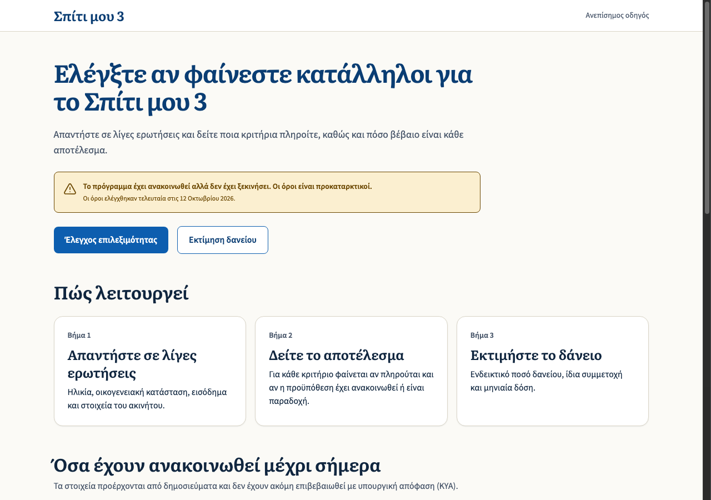
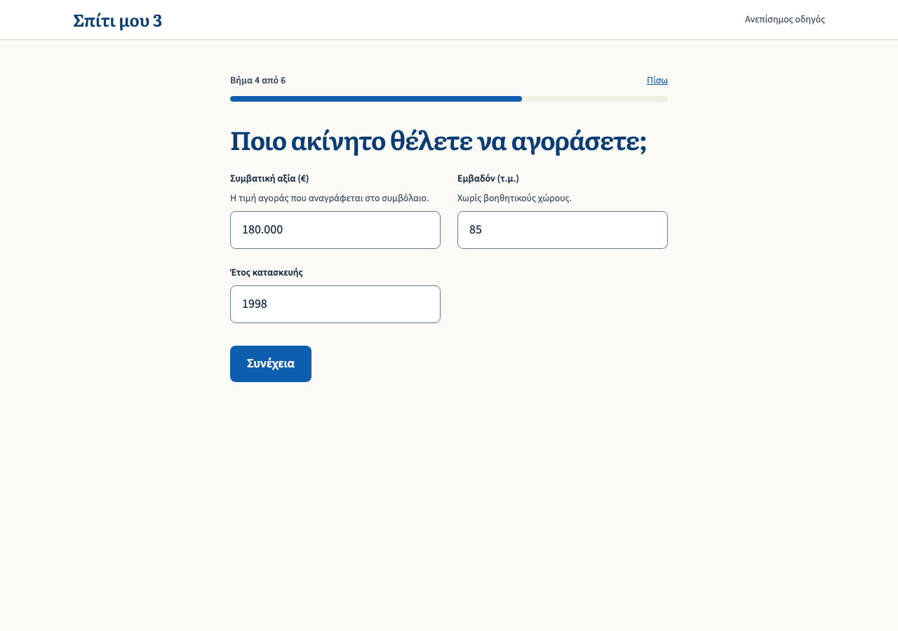
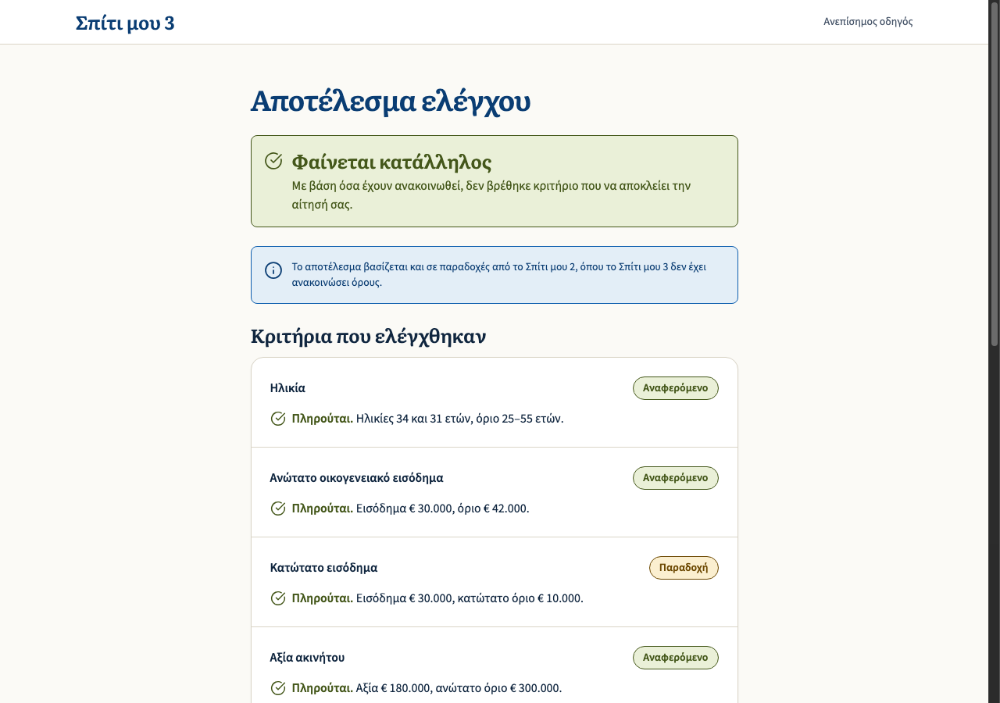
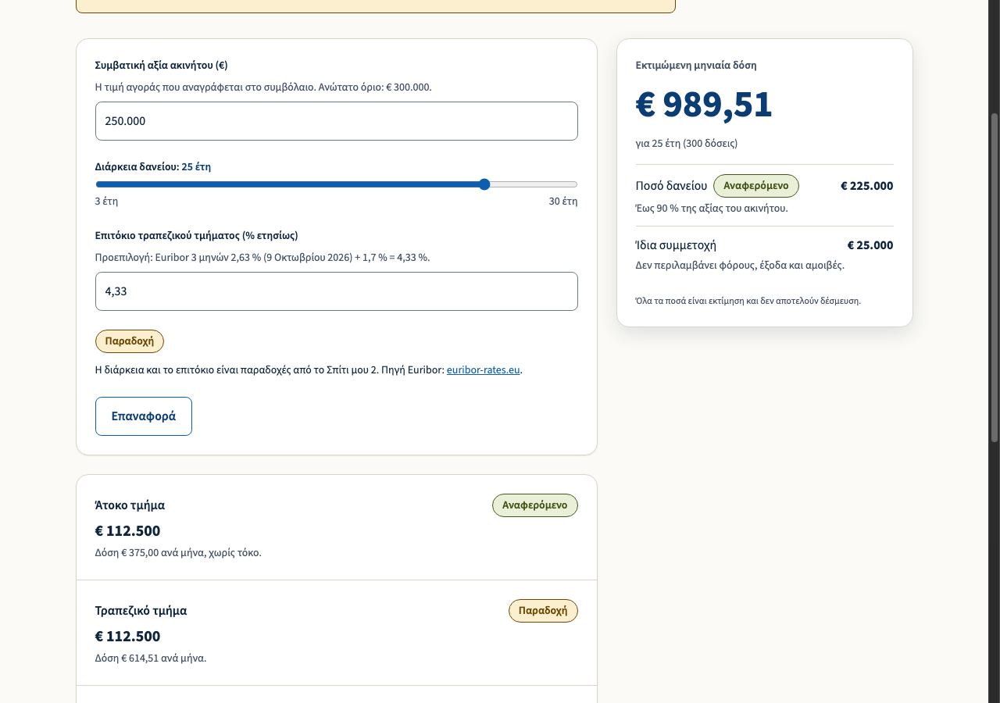

# My Home Three

**Σπίτι μου 3: έλεγχος κριτηρίων και υπολογισμός δανείου**

An unofficial, informational web app that helps people in Greece see whether they appear to qualify for the **Σπίτι μου 3** housing-loan programme, and roughly what the loan would cost. It is in Greek, runs entirely in the browser, and is honest about which numbers are announced and which are guesses.

> [!IMPORTANT]
> **This is not an official tool and not financial advice.**
> Σπίτι μου 3 has been announced but **has not launched**, and no ΚΥΑ/ΦΕΚ has been published. Every term here comes from Greek press reports (capital.gr, Naftemporiki, ot.gr) or is carried over from the closed Σπίτι μου 2 programme. The bank and the official platform make the binding decision.

<p align="center">
  
  
</p>
<p align="center">
  
  
</p>

## What it does

| Page | Route | What you get |
| --- | --- | --- |
| **Landing** | `/` | What the tool is, a "not launched yet" notice, and the announced figures with their sources. |
| **Eligibility checker** | `/elegxos` | Six short questions, one per screen. The result shows every criterion, whether it is met, and how firmly it is known. |
| **Loan calculator** | `/ypologismos` | Loan amount, own funds, the interest-free / bank split and the monthly instalment, updating live as you type. |

### Never claims more than it knows

Every criterion and every number carries one of three statuses, always shown as a word and never by colour alone:

| Status | Meaning |
| --- | --- |
| **Αναφερόμενο** (reported) | Stated for Σπίτι μου 3 in press reports, with a source link. |
| **Παραδοχή** (assumed) | Not announced for Σπίτι μου 3, so carried over from Σπίτι μου 2 and labelled as such. |
| **Άγνωστο** (unknown) | No data. Shown to the user but never evaluated. |

The verdict is *«Δεν φαίνεται να πληροίτε όλα τα κριτήρια»* only when a **reported** criterion fails. A failing **assumed** criterion produces *«Φαίνεται κατάλληλος, με επιφυλάξεις»*, a warning rather than a rejection. The app never says "eligible" or "approved".

### Private by design

- No backend, no accounts, nothing stored. Answers live in memory and never leave the browser.
- No third-party requests: the fonts are self-hosted, and there is no analytics.

## Getting started

You need a current Node.js LTS (developed on Node 22) and npm.

```bash
npm install
npm start          # dev server at http://localhost:4200
npm test           # unit and component tests (Vitest), watch mode
npm run build      # production build into dist/
```

Run the tests once, without watching:

```bash
npx ng test --watch=false
```

## Keeping the rules up to date

All programme rules live in **one file**, separate from the UI and the logic:

```
src/app/rules/spiti-mou-3.rules.ts
```

Each value has a `status` (`reported` or `assumed`), a `source` link, and the file has a `lastVerified` date that is shown to users. When the ΚΥΑ is published:

1. Update the values and set their status to `reported`, with the official source.
2. Move anything now announced out of `unknownCriteria` and add the matching check.
3. Update `lastVerified`.

The 3M Euribor used for the calculator's default rate is stored there too, with its date. It goes stale quickly, so refresh it when you touch the file.

## How it is built

- **Angular 22** with signals and standalone components
- **Tailwind CSS v4**, using the tokens of the project's design system (Aegean blue, whitewash, Literata + Source Sans 3)
- **Vitest** for tests. The eligibility and calculator logic are **pure functions with no Angular dependency**, written test-first, so they are fast to test and easy to audit.

```
src/app/
├── rules/        Rules data, key figures, el-GR formatting
├── checker/      Answer parsing, criteria evaluation, stepped UI
├── calculator/   Loan calculation, input parsing, live UI
├── landing/      Landing page
└── ui/           Shared pieces: header, field, notice, status badge
```

## Project documents

- [`.scratch/spiti-mou-3-app/spec.md`](.scratch/spiti-mou-3-app/spec.md): the product spec, including the criteria table and known risks
- [`CONTEXT.md`](CONTEXT.md): glossary of the domain terms (Greek terms are canonical)
- [`CLAUDE.md`](CLAUDE.md) and [`docs/agents/`](docs/agents/): configuration for AI coding agents working in this repo

## Sources

- [capital.gr, 11 Oct 2026](https://www.capital.gr/oikonomia/4022673/spiti-mou-3-ola-osa-allazoun-gia-ilikies-eisodimata-kai-oria-xrimatodotisis/)
- [Naftemporiki, 7 Sep 2026](https://www.naftemporiki.gr/finance/economy/2158040/spiti-moy-3-poioi-mpainoyn-sto-neo-programma-ta-nea-oria-gia-eisodima-ilikia-kai-akinito/)
- [ot.gr, 6 Sep 2026](https://www.ot.gr/2026/09/06/oikonomia/akinita/spiti-mou-3-ayksanetai-to-orio-aksias-akinitou-ta-kritiria/)
- Σπίτι μου 2 (for assumptions): [hdb.gr](https://hdb.gr/spiti-ii/), [stegasi.gov.gr](https://stegasi.gov.gr/programs/spiti-mou-ii/), [greece20.gov.gr](https://greece20.gov.gr/en/?p=35231)
